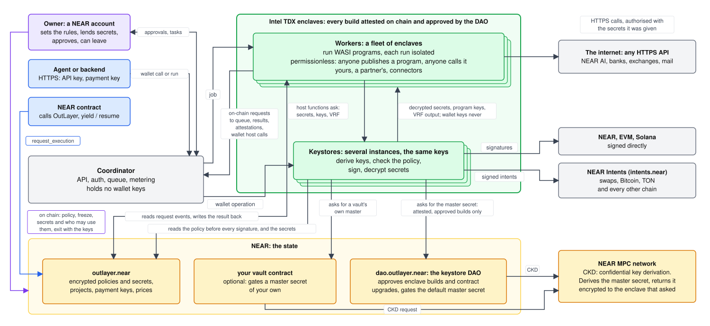
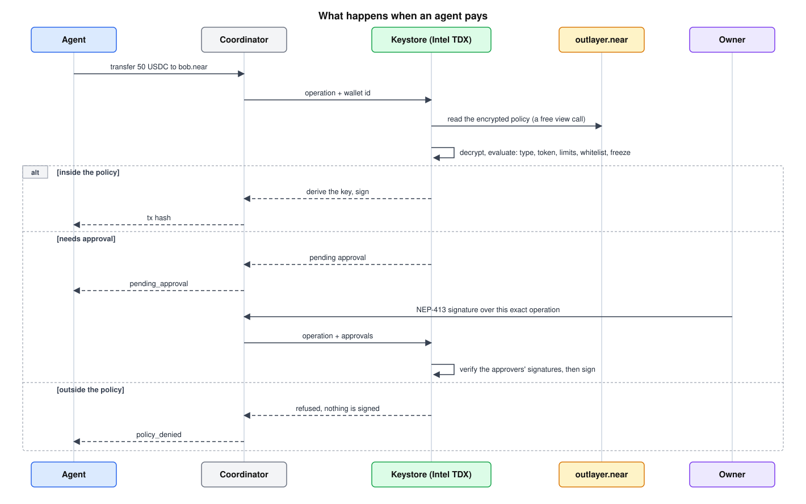

# NEAR OutLayer

**Verifiable compute and custody for AI agents, on NEAR**

- **A wallet for an agent, with the key and the policy in one enclave.** The agent gets addresses on NEAR, EVM chains and Solana, and an API key. The private key exists only inside an Intel TDX enclave, derived from a master secret that NEAR MPC issues only to attested, DAO-approved builds, and that same enclave checks the owner's policy before every signature. There is no path to a signature that goes around the policy.
- **A programmable enclave.** Any WASI program (code compiled to WebAssembly: one `.wasm` file that runs in a sandbox and touches only what the host hands it) runs next to the key, called from a NEAR contract or over HTTPS, and gets secrets, keys and storage as host functions, and the agent's wallet when the agent calls it with one. Code extends what an agent can do. It cannot extend what the agent is allowed to do.
- **You can always leave, with the keys.** A wallet's owner takes its keys out of OutLayer with a transaction on NEAR and a wait they chose, and keeps signing for the same addresses with keys derived on their own machine. No request to OutLayer, no consent, and it works if OutLayer stops. With a vault the secrets leave too. See [You can leave](#you-can-leave).
- **A DAO decides every change.** Which enclave builds may run and hold the master secret, which worker builds may execute code, and the contracts' own code all change only by a vote of the keystore DAO on chain. Software is approved by the hash of a reproducible build, so anyone can check what was voted. See [Governed by a DAO](#governed-by-a-dao).
- **State on chain.** Policies, secrets, approved builds and prices are contract state on NEAR. The owner changes the policy and freezes the wallet with a transaction, without asking OutLayer.

Every execution returns an Intel TDX attestation that binds the result to the WASM hash, the input and the measured worker that ran it.

Live on mainnet: 1.5M attested executions, self-hosted Intel TDX servers, five curated connectors (Hyperliquid, Polymarket, Mercury, GitHub, Gmail).

## Quick links

- **Dashboard & docs**: [app.outlayer.ai](https://app.outlayer.ai) (no API is served from this host)
- **HTTPS API**: `https://api.outlayer.ai` (mainnet), `https://testnet-api.outlayer.ai` (testnet)
- **Contract**: `outlayer.near` (mainnet), `outlayer.testnet` (testnet)
- **API reference**: [API.md](API.md), and the [OpenAPI spec](https://api.outlayer.ai/openapi.json)
- **Agent skills**: [skills.outlayer.ai/outlayer/SKILL.md](https://skills.outlayer.ai/outlayer/SKILL.md)
- **Live attestation of the worker fleet**: [workers.outlayer.ai](https://workers.outlayer.ai)
- **Production app**: [near.email](https://near.email), blockchain-native email built on OutLayer

## Architecture



- **Two doors, one runtime.** A call over HTTPS and a call from a NEAR contract (`request_execution` on `outlayer.near`, the result comes back in the contract's callback) run the same program in the same enclave. Either way the result comes with an attestation, kept by the coordinator and readable through the API; an on-chain call also gets its result written to `outlayer.near` by the worker's registered key.
- **Many programs, no permission needed.** Workers run any number of WASI programs side by side, each run isolated from the others. A program is a `.wasm` file named by its sha256, and publishing one asks nobody: its author can be you, a partner or a stranger. It gets the same primitives through host functions: secrets, keys and verifiable randomness straight from the keystore, the wallet through the coordinator's wallet API, which is the same path and the same policy check as an agent's own call.
- **Secrets open the outside world.** A program calls any HTTPS API: NEAR AI inference, a bank, an exchange, a mailbox. The credential is a secret stored encrypted on chain, which the keystore opens only for the callers its owner named. A user lends their own secret, an API key or a login, to an agent: for good, until a date they pick, or only to one exact build of the code. The program the agent calls uses it inside the enclave; the agent itself never receives it, and the user takes it back with one transaction.
- **The agent prepares, the owner approves, it runs.** What the agent may not do alone, it hands to its owner ready to go: "I've prepared a $2,000 invoice to Acme", "this email to the client", "a payment to a new address". The owner reads exactly what will happen in one inbox, on the site or at their own webhook, and approves with one wallet signature: no transaction, no fee. The platform then runs the agent at once, and that exact action executes in the agent's name. The agent can also ask for a value or a file, and leave notices of what it did. A payment the wallet policy holds for approval works the same way: the owner's signature over that exact operation releases it.
- **One place signs.** Every signature, asked for over the API or by a program, is made by the keystore, after it has read the wallet's policy from the chain.
- **Two sources of the master secret.** By default the keystore derives every key from a master that NEAR MPC issues through `dao.outlayer.near`. With a vault, a contract on your own account is the issuer: the vault's wallets and secrets derive from a master of your own, and you can take it out.
- **The chain is the source of truth.** The coordinator routes and meters. It holds no wallet keys, and no signing decision reads its database.
- **The owner acts on chain.** Policy, freeze, secrets and exit are transactions from the owner's account to a contract.



## What you get

### A wallet the agent cannot lose or leak

- **The key is never stored.** It is derived on demand inside the enclave from a master secret. No endpoint exports it.
- **The master comes from NEAR MPC, not from OutLayer.** The MPC network derives it (confidential key derivation) and releases it only to a keystore whose TDX attestation was verified on chain and whose build the DAO approved. Each release is a public transaction.
- **The agent holds an API key, not a private key.** A leaked API key is bounded by the policy and is revoked or frozen by the owner. The addresses and the funds stay.
- **No credential store for many users.** A deterministic wallet is addressed by a NEAR account plus a seed and authenticated by that account's signature. One NEAR key serves any number of user wallets, and removing the key revokes access within 60 seconds.
- **Free to create.** A wallet is a NEAR implicit account: one API call, no transaction, no storage deposit, no key registration on `intents.near`. An agent can register itself and hand its owner a link to take control.

### A policy evaluated next to the key

One policy per wallet, stored encrypted in `outlayer.near`, changed only by its controller account, enforced in the enclave:

- **What the wallet may do at all.** Transaction types (transfer, contract call, withdraw, swap, account deletion) and capabilities (cross-chain withdraw, limit order, payment check, confidential intents, EVM signing, Solana signing, raw signing). The capabilities are off by default under a policy.
- **Limits.** Per transaction and per hour, day and month, per token. An hourly rate limit. Time windows.
- **Addresses.** Whitelist or blacklist of recipients.
- **Approvals.** M-of-N approvers sign a NEP-413 message over the exact operation with their own wallets. The enclave verifies the signatures itself; the coordinator only carries them. An amount per hour, day or month can go out without approval, and a payment to an address off the whitelist can wait for the approvers instead of being refused.
- **Lock.** A locked policy changes only with its approvers' quorum, so one controller cannot rewrite two-of-two into one-of-one.
- **Freeze.** One transaction from the controller straight to the contract. It needs nothing from OutLayer's API.

An agent can propose anything. What is outside the policy is never signed, however the request is worded. A wallet with no policy is unrestricted: store a policy before funding it.

### You can leave

Neither exit needs OutLayer's API or consent. Each is a contract on NEAR, NEAR MPC and a tool the owner runs. Afterwards the owner signs for the same addresses with keys derived locally.

| | Owner exit | Vault exit |
|---|---|---|
| Set up | one transaction from any NEAR account, 0.05 NEAR | a vault contract on your own sub-account, 1 NEAR |
| Wait | 24 to 48 hours, chosen by the owner | 1 to 30 days, chosen at deployment |
| What leaves | the keys of all the owner's wallets | the wallets' keys and every secret bound to the vault |
| If OutLayer stops | works: the escrow is in the DAO contract, its key comes from NEAR MPC | works |
| Can governance remove it | only by an upgrade that waits longer than the exit takes | no, the vault's code is fixed |

With a vault the owner derives the vault's master again from NEAR MPC, in a runtime of their own or by hand, and with it every wallet key and secret of the vault. Details: [docs/EXITS.md](docs/EXITS.md).

### Governed by a DAO

`dao.outlayer.near`, the keystore DAO, governs the three contracts: itself, the main contract `outlayer.near` and the worker registry `worker.outlayer.near`. A proposal passes with a majority of the members and executes only after a public delay, so anyone watching the chain sees a change before it happens.

| Only a DAO vote can | How |
|---|---|
| Upgrade any of the contracts, the DAO included | members vote on the sha256 of a reproducible build; the contract deploys exactly that code |
| Approve the software a keystore runs, and its OS image | by the hash of the release, which anyone rebuilds from the published compose |
| Admit a keystore instance to the master secret | a vote on its verified Intel TDX attestation |
| Approve a worker build | its five TDX measurements go on the register's allowlist |
| Change the members, the delay, the operations owner | proposals like any other |

The operations owner runs day-to-day settings and holds only brakes (pause, revoke a build, cancel a request with a full refund) and bounded settings (prices, Intel's reference data). It cannot change code, keys, members or approvals, and the DAO replaces it with one vote. An owner's exit is not the DAO's decision at all: the contract checks the owner's account and the window they chose. Details: [docs/GOVERNANCE.md](docs/GOVERNANCE.md).

### One custody, many chains

- **Direct signing:** NEAR (ed25519), Solana (ed25519), EVM (secp256k1: EIP-712, EIP-191, raw transactions). One `0x` address covers Ethereum, Base, Arbitrum, Optimism, Polygon, BSC, Avalanche, HyperEVM and Robinhood Chain.
- **Everything else through NEAR Intents:** swaps, deposits from and withdrawals to every chain in the 1Click catalog (Bitcoin, TON, Tron and others), confidential intents, limit orders, gasless payment checks between agents.
- **No cross-chain replay.** Each chain family has its own derivation seed.

### Signing with no transaction and no gas

A signature costs one round trip to the keystore and one free view call. MPC is used once, to issue the master, not once per signature. An agent that acts every minute pays no signing overhead, and a refused operation costs nothing.

### Any WASI program, with the same primitives

- **Publish and run.** Write a WASI program (Rust SDK, WASI P1 and P2), publish the `.wasm` named by its sha256, call it. No infrastructure to run.
- **Host interfaces.** The custody wallet; encrypted secrets; persistent storage; verifiable randomness; NEAR RPC; outbound HTTP; tasks for the owner.
- **Keys of its own.** A program declares signing keys and encryption keys in its manifest. The keystore derives them per project or per exact build, and the program uses them without ever seeing them. With a signing key (ed25519 or secp256k1) it signs its own output, so anyone can check that this program produced it. With an encryption key it seals data that only the same program can open, so an application's records stay encrypted outside the enclave.
- **The policy travels with the wallet.** An agent calls a program with its wallet attached. When the program transfers, swaps or signs, the request is held to the owner's policy like any API call.
- **Secrets locked to code.** A secret can be opened only by one exact build, checked in the enclave against the hash the worker measured. A new version of the code does not get the secret until its owner moves the lock.
- **Connectors.** WASI programs we curate and price: named operations on an outside service, such as the owner's bank account, mailbox or GitHub login, or a trading venue (Mercury, Gmail, GitHub, Hyperliquid, Polymarket), without handing the agent a login or a key. Prices are per operation on chain, outbound network is limited to the hosts the manifest declares, and the owner writes the rules.

### Two ways in, one payment model

- **On chain.** A contract calls `request_execution`, attaches payment and resumes on the result in the same logical transaction. Unused budget is refunded.
- **HTTPS.** `POST https://api.outlayer.ai/call/{owner}/{project}` with a payment key: a prepaid stablecoin balance registered in the contract, with per-call and per-project limits. No wallet popup and no NEAR on the caller's side.
- **Earnings.** A caller can attach a payment for the program's author on either door; the author withdraws it in stablecoins.

### The agent can act as the user's own account

By default an agent acts as its own implicit account. With account binding it acts as `alice.near`: the user installs a small wallet contract by hash (a global contract) and adds the agent's executor to it. The user's own keys keep signing, the agent gets only what the policy allows, and one transaction ends it.

### Verifiable end to end

- **Registration.** Workers and keystores register with an Intel TDX quote, verified on chain against Intel PCS collateral, and all five measurements (MRTD, RTMR0-3) are checked, so a debug image fails even when the application matches. A worker's five must equal an approved set. A keystore's MRTD and RTMR0-2 must equal an approved OS image, and its RTMR3, which carries the instance's own id, is replayed from its boot event log and must name an approved release; each instance then takes a DAO vote of its own.
- **Builds.** The worker and keystore images are built by GitHub Actions with Sigstore build provenance, so an image digest traces to the source commit. Contracts are reproducible builds (`cargo near build reproducible-wasm`).
- **No builds in the enclave.** The TEE workers that run code and receive secrets never compile. They run a WASM binary whose sha256 they measure and report to the keystore with every secret decryption.
- **Every execution** returns an attestation. `outlayer-verify` re-checks its chain to Intel's root on your own machine.

## When to use OutLayer

- the agent acts often, and a transaction per signature would be too slow or too expensive;
- one agent identity must work on NEAR, EVM and Solana;
- the rules are richer than "who may sign" and must be exact where the key is;
- logic has to run next to the key: a venue integration, a strategy, an oracle, a signer for your own protocol;
- you need it now, with payments, secrets and storage already built.

It composes with other layers. An OutLayer wallet is an ordinary NEAR account, so a naming, recovery or timelock layer that targets NEAR accounts can sit above it.

## Using it

### A wallet for an agent

```bash
curl -s -X POST https://api.outlayer.ai/register
# {"api_key": "wk_...", "near_account_id": "36842e2f...", "handoff_url": "https://app.outlayer.ai/wallet?key=wk_..."}

curl -s -H "Authorization: Bearer $API_KEY" "https://api.outlayer.ai/wallet/v1/address?chain=near"
```

The owner opens the `handoff_url`, stores a policy and takes control. Every wallet operation, its policy and its refusals: [app.outlayer.ai/docs/agent-custody](https://app.outlayer.ai/docs/agent-custody).

### A program, from a NEAR contract

Your contract calls `request_execution` on `outlayer.near`, attaching NEAR for compute. The result comes back through NEAR's yield/resume.

```rust
#[ext_contract(ext_outlayer)]
trait OutLayer {
    fn request_execution(
        &mut self,
        source: ExecutionSource,
        resource_limits: Option<ResourceLimits>,
        input_data: Option<String>,
        secrets_ref: Option<SecretsReference>,
        response_format: Option<ResponseFormat>,
        payer_account_id: Option<AccountId>,
        params: Option<RequestParams>,
    );
}
```

A request without `resource_limits` only compiles and runs nothing: pass `{}` to take the defaults. See [contract/README.md](contract/README.md).

### A program, over HTTPS

```bash
curl -X POST https://api.outlayer.ai/call/alice.near/my-project \
  -H "X-Payment-Key: alice.near:1:your_secret_key" \
  -H "Content-Type: application/json" \
  -d '{"input": {"prompt": "Hello"}}'
```

A request names the code as a registered project, or as a WASM file by URL and sha256. The contract also accepts a GitHub repository and commit; building from GitHub is off unless the operator enables it (`BUILDS_ENABLED` on the coordinator), and those builds run on separate compile workers outside the TEE.

## Trust model

**What is trusted.** Intel TDX and its attestation chain. NEAR MPC, for the master secret. The keystore DAO, for which builds may hold it. The coordinator, for authenticating API keys, counting cumulative limits (daily, hourly and monthly caps can overshoot under a burst of concurrent requests), and supplying the solver-quoted message for swaps, cross-chain withdrawals, confidential intents, limit orders and payment checks. Per-transaction limits, approvals, whitelists and freeze are exact and decided only in the enclave. The coordinator moves into a TDX enclave of its own, attested and approved like the workers and keystores, once its active development settles; until then it stays a trusted, non-attested component.

**Hosts.** Workers and keystores run in Intel TDX confidential VMs on OutLayer's own bare-metal servers, deployed with [`deploy/self-hosted-tdx`](deploy/self-hosted-tdx/README.md). No third-party cloud service is in the attestation path.

**Governance.** The keystore DAO (`dao.outlayer.near`) has three members and decides two of three. It approves keystore and worker builds and governs the three contracts, none of which carries a full-access key; every change of code or approved builds waits a 72-hour public delay. See [docs/GOVERNANCE.md](docs/GOVERNANCE.md).

What each party can and cannot do, and every limit stated plainly: [docs/NON_CUSTODIAL.md](docs/NON_CUSTODIAL.md).

## Repository

```
outlayer/
├── contract/              # Main NEAR contract (outlayer.near)
├── register-contract/     # TEE worker registration (5-measurement TDX verification)
├── keystore-dao-contract/ # Keystore DAO: governance, keystore registration, owner exit (dao.outlayer.near)
├── vault-contract/        # Per-customer vault contract
├── worker/                # Execution workers (Rust + Tokio, wasmtime)
├── keystore-worker/       # Key derivation, policy, signing and secrets (Rust, runs in TEE)
├── sdk/outlayer/          # Rust SDK for WASI programs (crate `outlayer`)
├── connectors/            # Public connectors and probes; pro connectors live in private repositories
├── wasi-examples/         # Example WASI programs and the local test runner
├── self-hosted-scheduler/ # Scheduler for autonomous agents (submodule)
├── deploy/                # Self-hosted TDX deployment tooling
├── docker/                # Worker, keystore and compiler images
├── scripts/               # Deployment and utility scripts
└── tests/                 # Integration tests
```

Separate repositories:

| Component | Repository |
|-----------|------------|
| Coordinator (task queue, HTTPS API, PostgreSQL + Redis) | private: `out-layer/coordinator` |
| Dashboard (web UI + documentation) | [out-layer/dashboard](https://github.com/out-layer/dashboard) |
| CLI | [out-layer/outlayer-cli](https://github.com/out-layer/outlayer-cli) |
| TEE challenge-response auth, wallet policy engine | [out-layer/shared-tee-helpers](https://github.com/out-layer/shared-tee-helpers) |
| TypeScript SDK | [out-layer/sdk-js](https://github.com/out-layer/sdk-js) |

## Development

The coordinator is a private repository, so the full stack (coordinator + workers + keystore) cannot be run from this repository alone. What you can do from here:

- **Build and test the contracts**: `cd contract && ./build.sh` (uses `cargo near build`); the same for `register-contract/`, `keystore-dao-contract/`, `vault-contract/`
- **Build and unit-test the worker and keystore**: `cargo build` / `cargo test` in `worker/` and `keystore-worker/`; rebuild the release images to compare digests against the Sigstore attestations
- **Write and test a WASI program locally**: follow [wasi-examples/WASI_TUTORIAL.md](wasi-examples/WASI_TUTORIAL.md) and check the binary with [wasi-examples/wasi-test-runner](wasi-examples/wasi-test-runner/README.md)
- **Deploy and call it on the hosted network**: with the [OutLayer CLI](docs/CLI.md) against `testnet-api.outlayer.ai` or `api.outlayer.ai`

Prerequisites: Rust (each component pins its toolchain in `rust-toolchain.toml`), `cargo-near`, NEAR CLI, Docker (for reproducible image builds).

The architecture diagram is drawn by [docs/images/outlayer-architecture.py](docs/images/outlayer-architecture.py).

## Documentation

| Document | Description |
|----------|-------------|
| [app.outlayer.ai/docs](https://app.outlayer.ai/docs) | Developer documentation: getting started, HTTPS API, NEAR integration, agent custody |
| [API.md](API.md) | HTTPS API endpoints |
| [docs/CLI.md](docs/CLI.md) | Command-line interface |
| [docs/NON_CUSTODIAL.md](docs/NON_CUSTODIAL.md) | Custody model and its limits |
| [docs/GOVERNANCE.md](docs/GOVERNANCE.md) | The DAO, the operations owner, what each can change |
| [docs/EXITS.md](docs/EXITS.md) | Leaving with your keys: the owner exit and the vault exit side by side |
| [docs/MULTI_CHAIN.md](docs/MULTI_CHAIN.md) | NEAR, EVM and Solana signing from one wallet |
| [docs/DETERMINISTIC_WALLETS.md](docs/DETERMINISTIC_WALLETS.md) | Wallets addressed by a NEAR account and a seed, sub-agent keys, webhooks |
| [docs/PAYMENT_CHECKS.md](docs/PAYMENT_CHECKS.md) | Gasless payments between agents |
| [docs/CONNECTORS.md](docs/CONNECTORS.md) | Building a connector |
| [docs/TASKS.md](docs/TASKS.md) | Tasks between an agent and its owner |
| [VAULTS.md](VAULTS.md) | Per-customer vaults |
| [WORKER_ATTESTATION.md](WORKER_ATTESTATION.md) | TEE attestation in depth |
| [VRF.md](VRF.md) | Verifiable random function |
| [PROJECT.md](PROJECT.md) | Technical specification |
| [contract/README.md](contract/README.md) | Contract API reference |
| [worker/README.md](worker/README.md) | Worker configuration |
| [sdk/outlayer/README.md](sdk/outlayer/README.md) | Rust SDK |
| [wasi-examples/WASI_TUTORIAL.md](wasi-examples/WASI_TUTORIAL.md) | WASI development tutorial |
| [wasi-examples/BEST_PRACTICES_OUTLAYER_NEAR.md](wasi-examples/BEST_PRACTICES_OUTLAYER_NEAR.md) | Best practices |

### Using OutLayer with an AI coding assistant

Point the assistant at one of these instead of pasting files by hand:

| File | Contents |
|------|----------|
| [`/llms.txt`](https://app.outlayer.ai/llms.txt) | Index of every documentation page, with a one-line summary each, in the [llms.txt](https://llmstxt.org) format |
| [`/llms-full.txt`](https://app.outlayer.ai/llms-full.txt) | Full text of all developer docs, one fetch |
| [OpenAPI spec](https://api.outlayer.ai/openapi.json) | Machine-readable HTTPS API schema |
| [Agent skills](https://skills.outlayer.ai/outlayer/SKILL.md) | Drop-in skill files for agent frameworks |

Both `llms` files are built by the [dashboard](https://github.com/out-layer/dashboard) repository, partly from the markdown in this repository.

## License

Apache-2.0, except `sdk/outlayer/` and `wasi-examples/`, which are MIT OR Apache-2.0. See [LICENSING.md](LICENSING.md) for the full map.
