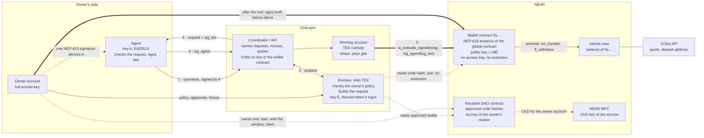
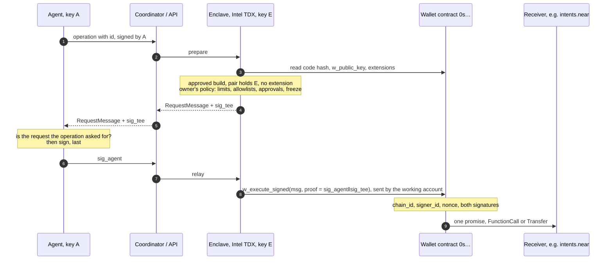

# Agent On-chain custody: the design

Agent On-chain custody keeps an AI agent's balance in the NEAR Intents wallet
contract, under a pair of keys: the agent's and one held in OutLayer's
enclave (Intel TDX). The chain requires both signatures on every move. The
enclave signs only an operation the owner's policy allows, and the agent signs
last. Neither key moves anything alone, and neither does OutLayer, the agent's
machine or NEAR MPC.

It is built from parts that already exist, used the way their authors meant
them to be used: the wallet contract with one added signing standard, a
deterministic account (NEP-616), a global contract named by its code hash,
and the 1Click API as it is.

This page is the design and its reasons. Routes, byte formats and the setup
are in the reference: [ON_CHAIN_CUSTODY.md](ON_CHAIN_CUSTODY.md).

## 1. What a contract that holds an agent's funds has to do

An agent acts on its own, around the clock, on input nobody reviewed. The
account that holds its money has to meet five requirements at once:

| # | Requirement | Where it is met |
|---|---|---|
| 1 | The chain itself refuses a move that two independent parties did not sign | [section 2](#2-the-wallet-contract-used-as-designed) |
| 2 | The party that checks the policy moves nothing alone | [section 3](#3-two-keys-and-where-each-comes-from) |
| 3 | The network that derives keys moves nothing alone | [section 3](#3-two-keys-and-where-each-comes-from) |
| 4 | The owner acts alone when the provider is gone | [section 6](#6-leaving-without-outlayer) |
| 5 | No new stateful code sits under the funds | [section 2](#2-the-wallet-contract-used-as-designed) |

## 2. The wallet contract, used as designed

The account is an instance of the NEAR Intents wallet contract
([`near/intents`, `contracts/wallet`](https://github.com/near/intents/tree/main/contracts/wallet)).
Nothing in the contract's core is changed. Each of its design choices is taken
at its word:

- **One more signing standard.** The contract is built so that "additional
  variants can be implemented by anyone", each deployed as its own global
  contract. Agent On-chain custody adds one: `wallet-two-key`
  ([`contracts/wallet/signatures/two-key`](https://github.com/out-layer/intents/tree/onchain-custody/contracts/wallet/signatures/two-key)),
  an implementation of `SignatureSchema` behind the `wallet!` macro. Its
  public key is the pair `A ‖ E` of two Ed25519 keys; its proof is two
  signatures over the request's hash, the agent's under the prefix
  `NEAR_WALLET_TWO_KEY/V1/AGENT` and the enclave's under
  `NEAR_WALLET_TWO_KEY/V1/TEE`. A signature of one role is never valid for the
  other, and a pair with equal or weak keys is refused. It is about two
  hundred lines of signature verification with no state, no clock and no
  queue: the whole of what a reviewer reads beyond the core.
- **A public key that cannot be changed.** The wallet contract fixes its
  public key at the first initialization. With the pair as that key, "both
  must sign" is a permanent rule of the account, not a setting.
- **A deterministic account (NEP-616).** The address is `0s…`, derived from
  the `StateInit`: the code hash of the build and the first state with the
  pair. It commits to both, so the address alone says which code runs and
  whose keys it answers to. One `DeterministicStateInit` action creates it,
  and anyone can send that action: no factory, no deploy by the owner, and no
  access key on the account at any moment of its life.
- **A zero-balance account.** A fresh wallet contract takes 265 bytes of the
  770 the protocol stores for free, so the account needs no NEAR to exist.
- **Nonces as the contract recommends.** The contract keeps "double-timeout
  window" nonces in a bitmap and recommends that a single signer generate
  them incrementally. The coordinator gives a wallet's requests consecutive
  nonces, so 32 requests share one 8-byte entry, and the contract's own
  rotation drops them after two timeouts. The state stays inside the
  zero-balance limit under an agent's ordinary load.
- **A permissionless relayer.** A signed request is executed by whoever
  delivers it. The agent's working account relays and pays the gas; the
  wallet contract itself holds the balance and nothing else.
- **Extensions have full control, so there are none.** The contract's README
  says an extension controls the instance. The enclave therefore never signs
  the addition of an extension, and signs for no wallet contract that has one.
- **A global contract by its code hash.** The account names its code by hash,
  so the installing transaction carries no code and the account cannot be
  moved to other code. The keystore DAO approves builds by that hash, and the
  enclave reads the account's hash from the chain before every signature.

On chain, the new code under the funds is the signing standard. There is no
contract of OutLayer's on the path of the money, and none that OutLayer can
upgrade.

## 3. Two keys, and where each comes from

| Key | Where it comes from | Who can make it |
|---|---|---|
| A, the agent's | one NEP-413 signature of the owner's full-access key over a fixed message that names the owner and the wallet; the key's seed is an HMAC of that signature | the owner, in their own wallet, at any time. The enclave never sees it |
| E, the enclave's | derived inside the enclave from the owner's master and the wallet's id, at the moment of signing; stored nowhere | the enclave; the owner after an exit |

The two keys have different origins on purpose. A comes from the owner's own
key and passes through no service: the owner's page seals it to the agent, and
the API carries a ciphertext it cannot open. Ed25519 signatures are
deterministic, so the same signature gives the same key again and the agent's
key needs no backup. E follows from the owner's master, which NEAR MPC
protects.

What each party can do alone:

| Party | Alone it can | Alone it cannot |
|---|---|---|
| Agent (A) | ask for an operation | move anything: E is required, and the enclave gives it under the policy |
| Enclave (E) | refuse | move anything out of the wallet contract: A is required |
| Coordinator / API | carry and relay | sign either half, or ask in the agent's name |
| NEAR MPC | reach E, through the master | reach A; move anything in the wallet contract |
| Owner account | store the policy, approve, freeze; hold both keys after an exit | — |
| Wallet contract | — | execute without both signatures |

## 4. One operation

Three rules make this more than "two signatures":

- **The enclave builds the request; it never signs one it is handed.** The
  agent signs an operation ("transfer this much to that account", "swap", "call
  this method"). The enclave turns it into the wallet contract's request
  itself: one promise to another account, with one function call or one
  transfer. No route takes a request to sign as it is, a second promise, or
  one of the wallet contract's own operations.
- **The enclave reads the chain before every signature.** The account runs an
  approved build, its pair holds this wallet's enclave key, it has no
  extension and it accepts signatures. The link between a wallet and its
  wallet contract is this check, not a database row.
- **The agent signs last.** The enclave's half exists only for an operation
  that passed the policy and its approvals, and the agent compares the request
  with what it asked for before it signs. A refused or a waiting operation
  leaves no half of a move anywhere.

The owner's policy is what the enclave holds every operation to: limits per
transaction and per period, allowlists of receivers and of operation kinds, approvals by
M of N approvers above a threshold, a freeze, and a lock that puts a change of
the policy itself, and an exit, under the same approvers.

## 5. What a compromise reaches

| What is compromised | What it reaches in the wallet contract |
|---|---|
| The enclave's memory | E, and no signature of the agent: nothing moves. The agent signs last, so no signed half of a refused move exists to be found |
| OutLayer's governance: a hostile build or upgrade | E at most, and still no move without the agent's signature |
| The coordinator | no key and no move; the enclave verifies the agent's signature and reads the wallet contract itself |
| The agent's machine | A. Every operation still passes the enclave's policy; the owner freezes the wallet |
| A prompt injection into the agent | an operation request, which the enclave judges by the policy |
| The owner's key, under a locked policy | what the policy allows as it stands: a change of policy and an exit both need the approvers |
| NEAR MPC | E, through the master; not A, which comes from the owner's own signature. Nothing moves |

For funds to move against the owner's policy, the enclave and the agent's own
key have to fail together. No single system on the list is enough, the network
that derives keys included.

## 6. Leaving without OutLayer

The owner leaves alone, holding both keys of every wallet contract they own
([OWNER_EXIT.md](OWNER_EXIT.md)).

The owner's master is escrowed in the keystore DAO contract, sealed under a
key only NEAR MPC can produce for that owner. The contract builds the key's
path from the account that calls it, so the exit belongs to the owner account
by its name. The owner starts an exit, waits the window they chose, and claims
the master. From it they derive E; their wallet repeats one signature and
gives A; and an offline tool builds a request with both halves that any NEAR
account can relay. No OutLayer service takes part: NEAR and NEAR MPC are
enough.

After the exit the owner is the only holder of both keys, and the wallet
contract is an ordinary Intents wallet of theirs.

## 7. Questions for any design that holds an agent's funds

| Question | Agent On-chain custody |
|---|---|
| Who has to fail together for funds to move against the policy? | the enclave and the agent's key |
| What can the party that checks the policy do alone? | refuse |
| What can the network that derives keys do alone? | reach one key of the two |
| What runs for each move? | one NEAR transaction with two Ed25519 verifications; no signing round of a network |
| How does the owner act with the provider gone? | the owner exit: both keys, signed offline |
| What new contract code sits under the funds? | one signing standard, with no state and no clock |
| What does the agent reach beyond the chain? | every OutLayer connector and secret, under the same owner's policy and approvals |

## 8. NEAR Intents and other chains

The wallet contract holds its balance in `intents.near` like any Intents
account. A swap or a withdrawal to another chain goes through the 1Click API
as it is: the quote names the wallet contract as recipient and refund
address, and the wallet contract funds it with one `mt_transfer` to the
quote's deposit address. A withdrawal on NEAR is `ft_withdraw`. Each is one
request under two signatures.

The signing standard also implements the off-chain side of the contract
(`verify_offchain_msg`, behind `w_resolve_auth`, NEP-641): the same pair
authorizes an off-chain message under the same two signatures, with nothing
to add on the wallet's side.

## 9. Two modes that compose

OutLayer has two modes of custody, and an agent uses both.

**TEE custody** is the agent's working account: its keys live in the enclave,
under the same owner's policy. It signs on NEAR, in NEAR Intents, on EVM
chains and Solana, holds a confidential balance, trades on venues, and needs
neither a key on the agent's side nor a transaction per move. It is the right
tool for a balance that works all day.

**Agent On-chain custody** is the agent's main balance: the wallet contract,
where the chain requires two signatures.

The agent moves funds between the two as its work needs, and the owner decides
how much stands where. Connectors, secrets and programs serve both: a program
run with `use_bound_identity` acts under the wallet contract's name, so an
agent has one identity for its funds and for everything it does with them.

## Reference

- [ON_CHAIN_CUSTODY.md](ON_CHAIN_CUSTODY.md): the setup, the routes, statuses, limits, byte formats
- [OWNER_EXIT.md](OWNER_EXIT.md): the owner exit
- [`wallet-two-key`](https://github.com/out-layer/intents/tree/onchain-custody/contracts/wallet/signatures/two-key): the signing standard and its tests
- [`contracts/wallet`](https://github.com/near/intents/tree/main/contracts/wallet): the NEAR Intents wallet contract
